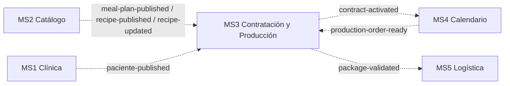

# MS3 en la plataforma Nur-Tricenter

Cómo se conecta MS3 (Contratación y Producción) con el resto de la plataforma de la
organización `Nur-tricenter`:

- `nur-tricenter-local`: orquestador.
- `nur-tricenter-api-gateway`: YARP + Consul.
- `nur-tricenter-identity`: JWT y service accounts.
- `nur-tricenter-shared-kernels`: contratos y permisos.
- `ms2-plans-and-recipes-catalog` (MS2), `ms4-delivery-schedule-management` (MS4) y
  `ms5-logistics-and-delivery` (MS5).

Las reglas del equipo para eventos, contratos y fichas viven en el repo `knowledge`
(`CONTRIBUTING.md`, `contracts/README.md`).

## Resumen de la comunicación



Every arrow is a RabbitMQ event: there is no REST between services (only a browser or the demo console, through
the gateway).

| Con | Dirección | Medio | Por qué |
|---|---|---|---|
| MS2 | MS2 → MS3 | Eventos | MS3 solo necesita una copia local de planes y recetas; no consulta a MS2 en cada request |
| MS1 | MS1 → MS3 | Evento | MS3 only needs a local copy of the patients (contract check, label name and phone) |
| MS4 | MS3 → MS4 | Evento | `ContractActivated`: MS4 creates the calendar (idempotent by contract id) |
| MS4 | MS4 → MS3 | Evento | `ProductionOrderReady`: the next-day deliveries, projected locally |
| MS5 | MS3 → MS5 | Evento | Un hecho de MS3 ("paquete validado") que logística toma cuando quiera; MS5 todavía no lo consume |

## Qué se copió de la plataforma

| Pieza de la plataforma | En MS3 |
|---|---|
| Transporte `Joseco.Communication.External.RabbitMQ` 1.1.0 | `Nurtricenter.MS3.WorkerService` (publicador y consumidores) |
| Exchanges `fanout`, no durables, una cola por consumidor `msN.<exchange>` | `package-validated`; colas `ms3.*` del catálogo |
| Proceso API + proceso Worker | `Nurtricenter.Api` + `Nurtricenter.MS3.WorkerService` |
| Outbox transaccional drenado por el worker | Tabla `OutgoingIntegrationEvents` + `OutboxRelay` |
| Inbox idempotente (claim + proyección en un solo `SaveChanges`) | `IdempotentConsumer<T, TInner>` + tabla `InboxMessages` |
| Auto-registro en Consul con check HTTP a `/health` | `Infrastructure/Discovery/ServiceRegistration` |
| Fragmento compose de plataforma + compose standalone | `contracting.compose.yml` + `docker-compose.yml` |
| Flag `Projections__Enabled` (platform only) | `MessagingExtensions.AddCatalogProjections` → `ProjectedDataSimulationService` |
| Flags `Migrations__ApplyOnStartup`, `Seed__Enabled`, `Swagger__Enabled` | `Program.cs` de la API (por defecto siguen a `IsDevelopment()`) |

## MS2 → MS3: eventos del catálogo

| Cola | Exchange | Contrato | Efecto en MS3 |
|---|---|---|---|
| `ms3.meal-plan-published` | `meal-plan-published` | `MealPlanPublished` | Upsert en `CatalogPlans` |
| `ms3.recipe-published` | `recipe-published` | `RecipePublished` | Upsert en `CatalogRecipes` |
| `ms3.recipe-updated` | `recipe-updated` | `RecipeUpdated` | Upsert en `CatalogRecipes` |

Las proyecciones se usan a través de `CatalogProjectionSimulationService`, que
decora `ISimulationService`:

- **`GetPlan`:** primero la simulación determinista; si no existe, el plan
  proyectado, con `DurationDays = TotalDays`. Así `POST /api/v1/contracts` acepta
  planes reales de MS2.
- **`GetRecipeName`:** nombre real de la receta en la orden de producción diaria;
  si no se conoce, se mantiene `Recipe-xxxxxxxx`.

## MS1 → MS3: patients (event `paciente-published`)

MS3 no longer calls MS1. MS1 publishes the kernel contract `PatientPublished` (patient id, document, first and
last name, phone) to `paciente-published` when a patient is created; the queue `ms3.paciente-published` feeds
`PatientPublishedConsumer`, which upserts the `ClinicPatients` table (a snapshot older than the stored row is
ignored). With `Projections__Enabled=true` (the platform) `ProjectedDataSimulationService.GetPatient` reads that
table: the full name is `FirstName` + `LastName`, the phone feeds the package label, and an unknown patient is
`PATIENT_NOT_FOUND` (404) — also when the sample data knows the id. Without the flag (standalone) the 3 simulated
patients stay.

Known limit: there is no backfill. A patient created before the deploy is not projected, so a contract for it
answers 404 until MS1 publishes it again.

## MS3 → MS4: event `contract-activated`

MS3 no longer calls MS4 over HTTP and no longer needs the `ms3-service` token for it (the account still exists in
identity because the demo console's security view uses it).

1. `POST /api/v1/billing/charge-plan` activates the contract and stores a `CreateSchedule` row in the outbox in the
   same transaction. Its payload carries `durationDays` (from `ISimulationService.GetPlan`: simulated or projected
   from MS2) and `startDate` (the day after the payment, UTC).
2. The worker (`OutboxRelay`) publishes it as `ContractActivated` to the `contract-activated` exchange
   (`declareDestination: true`). The outbox row id is the message id, so a redelivery after a lost ack carries the
   same `Id` and MS4's inbox drops it.

   ```json
   { "ContractId": "…", "PatientId": "…", "CatalogPlanId": "…", "DurationDays": 30, "StartDate": "2026-10-25" }
   ```

3. MS4 consumes it from `ms4.contract-activated` and creates the calendar (idempotent by contract id). Data MS4
   rejects (duration that is not 15/30 or that contradicts the plan) is logged and acknowledged there; MS3 does not
   learn about it.

| Outbox row | Meaning |
|---|---|
| `Published` | The broker accepted the message |
| `Rejected` | The payload has no `durationDays` (unknown plan): MS4 could not build a calendar, no retry would help |
| `Simulated` (pending) | Broker down; retried every 5 s |

## MS4 → MS3: next-day deliveries (event `production-order-ready`)

MS3 no longer calls `GET /calendars/active-tomorrow`. After `resolve-daily-catalog`, MS4 publishes the kernel
contract `ProductionOrderReady` — a full snapshot of one delivery date's order — to `production-order-ready`. The
queue `ms3.production-order-ready` feeds `ProductionOrderReadyConsumer`, which replaces the `ScheduledDeliveries`
rows of that `DeliveryDate` (a snapshot older than the stored rows is ignored; a day that moved date is matched by
its id). With `Projections__Enabled=true`, `ProjectedDataSimulationService.GetActiveCalendars` serves them to the
daily order (`GET /v1/production/daily-order`), the label and the validation:

| `ProductionOrderReady` line | MS3 (`SimActiveCalendar`) |
|---|---|
| `DeliveryDayId` (int) | `PackageId` (derived Guid: `000000xx-0000-0000-0000-000000000000`) and `DeliveryDayId` |
| `PatientId`, `PlanId` | same |
| `Address`, `Latitude`, `Longitude` | same |
| `Hour` (`HH:mm` or `null`) | `DeliveryTime` (empty when `null`) |
| `Menu` (meal time, order, recipe id and name, rations) | `Menu` (`SimMenuItem`), ordered by meal time order |

The daily order (`GetDailyOrderQueryHandler`) builds its items as before: it sums `rations` per recipe from the
menu; without a menu (standalone) it uses the simulated plan structure; with no recipe at all it answers **422
`NO_RECIPES`**. If MS4 has not published an order for the date, there are no deliveries and the daily order answers
404 `NO_CALENDARS`; unlike before there is no MS4 outage error, because nothing is called.

## MS3 → MS5: evento `package-validated`

| Evento interno (`EventType`) | Exchange | Contrato | Cola destino |
|---|---|---|---|
| `TransferToLogistics` (al aprobar calidad de un paquete) | `package-validated` | `PackageValidated` | `ms5.package-validated` |

```json
{
  "EventType": "Package.Validated",
  "PackageId": "9b2e…",
  "PatientId": "00000000-0000-0000-0000-000000000001",
  "ProductionOrderId": "4d1a…",
  "CatalogPlanId": "10000000-0000-0000-0000-000000000001",
  "ReleasedAt": "2026-10-23T15:30:00Z",
  "DeliveryAddress": "Av. Las Flores #123",
  "TrackingNumber": "NTR-9B2E41C0-20261023",
  "Latitude": -12.0464,
  "Longitude": -77.0428,
  "Id": "<id de la fila del outbox>",
  "CreatedAt": "2026-10-23T15:30:00+00:00",
  "CorrelationId": "<id de la fila del outbox>",
  "Source": "contracting"
}
```

- `DeliveryAddress` y `TrackingNumber` salen de la etiqueta del paquete.
- `Latitude` y `Longitude` salen del calendario activo de MS4 del mismo paciente
  cuya dirección coincide con la de la etiqueta. Si ninguno coincide, van en `null`.
- El `Id` del mensaje es el de la fila del outbox: si el worker se cae entre
  publicar y marcar la fila, la republicación lleva el mismo `Id` y el consumidor
  la descarta.
- MS5 todavía no consume esta cola: recibe paquetes por `POST /api/v1/packages/deliveries`.
  El mapeo de campos para su futuro consumidor está en
  [PRUEBAS_INTEGRACION.md](PRUEBAS_INTEGRACION.md).

## Ciclo de vida de una fila del outbox

```
Simulated ──entrega OK──────────────────────▶ Published (PublishedAt)
    ├── falta duración del plan ────────────────▶ Rejected
    ├── sin destino o payload inválido ─────────▶ Unroutable
    └── broker caído ───────────────────────────▶ sigue Simulated (reintento cada 5 s)
```

`Simulated` significa "pendiente" (`OutgoingIntegrationEvent.PendingStatus`); el
nombre se conserva por compatibilidad con las pruebas existentes.
`GET /api/v1/sim/outgoing/{eventType}` sirve para inspeccionar las filas.

## Cómo levantarlo

### Dentro de la plataforma

`setup-project` clona `ms3-contract-and-production` al lado de `nur-tricenter-local`,
y `start-stack` lo compila, lo levanta y crea `ms3-service`.

```bash
cd ../nur-tricenter-local && pwsh ./scripts/start-stack.ps1
```

- Gateway: `http://localhost:15005/api/contracting/v1/contracts/{id}`.
- Swagger de MS3 (solo con `start-stack-dev`): `http://localhost:18083/swagger`.
- RabbitMQ: `http://localhost:15672` (guest / guest).

Catálogo, identity y MS4 dependen de los kernels privados `Nur.Tricenter.*` (GitHub
Packages): sin `NUGET_TOKEN` no compilan. Sin identity ni MS4, las filas
`CreateSchedule` quedan pendientes y la orden diaria falla.

### Solo MS3 (standalone)

```bash
docker compose up --build
```

Levanta:

- Postgres en `5434`.
- RabbitMQ en `5672`/`15672`, con la topología de `topology/`.
- La API en `8080`, con Swagger encendido.
- El worker.

Sin MS4: los calendarios activos son los simulados y `CreateSchedule` queda
`Unroutable`. Para simular a MS2, publicar desde la UI de RabbitMQ en
`meal-plan-published` un JSON con la forma de `MealPlanPublished`.

### Local sin Docker

Copiar `appsettings.Development.template.json` a `appsettings.Development.json`
en `Nurtricenter.Api` y en `Nurtricenter.MS3.WorkerService`, ajustar las cadenas de
conexión y correr ambos con `dotnet run`.

## Decisiones y pendientes

- **Contratos locales en vez de `Nur.Tricenter.Integration`.** La regla del equipo es
  que los contratos vivan solo en el kernel. `PackageValidated` ya está en la rama
  `feat/contracting-messages` del kernel (versión 1.2.0).
  - Mientras no haya `NUGET_TOKEN`, MS3 usa copias locales en
    `Infrastructure/Messaging/Contracts/`.
  - Es seguro porque el publicador de Joseco serializa sin `$type`: basta con que
    coincidan los nombres de propiedades.
  - Con el token, las copias se reemplazan por el paquete.
- **`MealPlanPublished` no trae precio.** El plan proyectado se expone con
  `Cost = 0`; hoy ningún handler usa `Cost`, porque el monto llega en el pago.
- **MS4 solo acepta 15 o 30 días.** Un plan de MS2 con otra duración termina en
  `Rejected`.
- **La estructura de los planes sigue simulada.** El catálogo no publica la
  composición del plan (comidas → recetas).
- **Colas `ms3.food-*` y `ms3.user-*`:** existen en la topología pero MS3 no las
  consume; acumulan mensajes (gap transversal X-06).
- **Autenticación.** Los endpoints de MS3 siguen `AllowAnonymous()` y MS3 no tiene
  scopes en el kernel. Validar JWT como MS2 y MS4 es un paso aparte.
