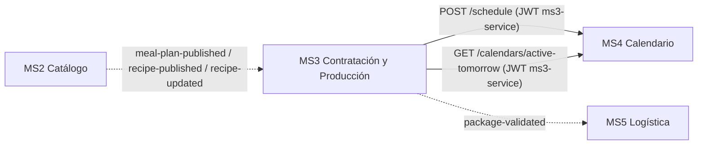

# MS3 en la plataforma Nur-Tricenter

Cómo se conecta MS3 (Contratación y Producción) con el resto de la plataforma de la
organización `Nur-tricenter`:

- `nur-tricenter-local`: orquestador.
- `nur-tricenter-api-gateway`: YARP + Consul.
- `nur-tricenter-identity`: JWT y service accounts.
- `nur-tricenter-shared-kernels`: contratos y permisos.
- `ms2-plans-and-recipes-catalog` (MS2), `ms4-delivery-schedule-management` (MS4) y
  `ms5-logistics-and-delivery` (MS5).

Las reglas del equipo para eventos, contratos y fichas viven en el repo `knowledge`
(`CONTRIBUTING.md`, `contracts/README.md`).

## Resumen de la comunicación



Flecha continua = REST a través del gateway. Punteada = evento por RabbitMQ.

| Con | Dirección | Medio | Por qué |
|---|---|---|---|
| MS2 | MS2 → MS3 | Eventos | MS3 solo necesita una copia local de planes y recetas; no consulta a MS2 en cada request |
| MS4 | MS3 → MS4 | REST con JWT | Es el diseño de MS4: `POST /schedule` es idempotente por `contractId` y `active-tomorrow` es una consulta puntual de la noche anterior |
| MS5 | MS3 → MS5 | Evento | Un hecho de MS3 ("paquete validado") que logística toma cuando quiera; MS5 todavía no lo consume |

## Qué se copió de la plataforma

| Pieza de la plataforma | En MS3 |
|---|---|
| Transporte `Joseco.Communication.External.RabbitMQ` 1.1.0 | `Nurtricenter.MS3.WorkerService` (publicador y consumidores) |
| Exchanges `fanout`, no durables, una cola por consumidor `msN.<exchange>` | `package-validated`; colas `ms3.*` del catálogo |
| Proceso API + proceso Worker | `Nurtricenter.Api` + `Nurtricenter.MS3.WorkerService` |
| Outbox transaccional drenado por el worker | Tabla `OutgoingIntegrationEvents` + `OutboxRelay` |
| Inbox idempotente (claim + proyección en un solo `SaveChanges`) | `IdempotentConsumer<T, TInner>` + tabla `InboxMessages` |
| Service account para llamadas servicio → servicio (como `ms4-service`) | `ms3-service` + `Infrastructure/DeliveryCalendar/ServiceAccountTokenHandler` |
| Auto-registro en Consul con check HTTP a `/health` | `Infrastructure/Discovery/ServiceRegistration` |
| Fragmento compose de plataforma + compose standalone | `contracting.compose.yml` + `docker-compose.yml` |
| Flags `Migrations__ApplyOnStartup`, `Seed__Enabled`, `Swagger__Enabled` | `Program.cs` de la API (por defecto siguen a `IsDevelopment()`) |

## MS2 → MS3: eventos del catálogo

| Cola | Exchange | Contrato | Efecto en MS3 |
|---|---|---|---|
| `ms3.meal-plan-published` | `meal-plan-published` | `MealPlanPublished` | Upsert en `CatalogPlans` |
| `ms3.recipe-published` | `recipe-published` | `RecipePublished` | Upsert en `CatalogRecipes` |
| `ms3.recipe-updated` | `recipe-updated` | `RecipeUpdated` | Upsert en `CatalogRecipes` |

Las proyecciones se usan a través de `CatalogProjectionSimulationService`, que
decora `ISimulationService`:

- **`GetPlan`:** primero la simulación determinista; si no existe, el plan
  proyectado, con `DurationDays = TotalDays`. Así `POST /api/v1/contracts` acepta
  planes reales de MS2.
- **`GetRecipeName`:** nombre real de la receta en la orden de producción diaria;
  si no se conoce, se mantiene `Recipe-xxxxxxxx`.

## MS3 → MS4: REST con la service account `ms3-service`

MS3 llama a MS4 a través del gateway (`DeliveryCalendar__BaseUrl`, en la plataforma
`http://gateway:8080`). Usa un JWT de la service account `ms3-service`, que
`start-stack` crea en identity con los scopes `deliveryCalendar.calendar:create` y
`deliveryCalendar.productionOrder:read`.

`ServiceAccountTokenProvider` inicia sesión en
`/api/identity-service/v1/auth/login`, cachea el token hasta 60 s antes de que
expire, y lo agrega como `Bearer` en cada llamada a MS4. Si MS4 responde 401 a un GET,
renueva el token y reintenta una vez.

### Crear el calendario al cobrar el contrato: `POST /api/delivery-calendar/v1/schedule`

1. `POST /api/v1/billing/charge-plan` activa el contrato y guarda en el outbox una
   fila `CreateSchedule` en la misma transacción. Su payload incluye:
   - **`durationDays`:** duración del plan (`ISimulationService.GetPlan`: simulado o
     proyectado desde MS2).
   - **`startDate`:** el día siguiente al pago (UTC).
2. El worker (`OutboxRelay`) la entrega como `POST /schedule`:

   ```json
   { "contractId": "…", "patientId": "…", "planId": "…", "duration": 30, "startDate": "2026-10-25" }
   ```

3. Resultado:

| Respuesta de MS4 | Estado de la fila | Qué significa |
|---|---|---|
| 200 | `Published` | Calendario creado, o ya existía para ese `contractId` (MS4 es idempotente) |
| 400 / 422 | `Rejected` | MS4 no acepta el calendario (p. ej. la duración no es 15 ni 30). No se reintenta |
| 401, 5xx, red caída | sigue `Simulated` | Se reintenta en el siguiente ciclo del worker |
| `DeliveryCalendar__BaseUrl` sin configurar | `Unroutable` | Modo standalone, sin MS4 |
| Payload sin `durationDays` (plan desconocido) | `Rejected` | MS4 necesita la duración |

### Orden de producción: `GET /api/delivery-calendar/v1/calendars/active-tomorrow?date=`

Con MS4 configurado, `DeliveryCalendarSimulationService` reemplaza los calendarios
simulados. Los usan la orden diaria (`GET /v1/production/daily-order`), la etiqueta
y la validación de paquetes. La respuesta de MS4 se traduce al modelo de MS3:

| MS4 (`ActiveTomorrowLineDto`) | MS3 (`SimActiveCalendar`) |
|---|---|
| `packId` (int) | `PackageId` (GUID derivado: `000000xx-0000-0000-0000-000000000000`) |
| `patientId`, `planId` | iguales |
| `address`, `latitude`, `longitude` | iguales |
| `hour` | `DeliveryTime` (`HH:mm`, vacío si es `null`) |
| `menu` (`mealTime`, `mealTimeOrder`, `recipeId`, `recipeName`, `rations`) | `Menu` (`SimMenuItem`: tiempo de comida, receta, nombre, raciones), ordenado por `mealTimeOrder` |

`menu` es la foto del menú del día que MS4 toma en `resolve-daily-catalog`
consultando a MS2. Es un campo **nuevo** que MS3 le propone a MS4 (rama
`feat/active-tomorrow-menu` de `ms4-delivery-schedule-management`). Sin él, MS3 no
sabe qué recetas lleva un plan real de MS2, porque la composición del plan solo la
tiene MS2 y MS4 ya la resolvió.

La orden diaria (`GetDailyOrderQueryHandler`) arma sus ítems así:

1. Si el calendario trae `menu`, suma `rations` por receta con el nombre que vino de MS4.
2. Si no lo trae (MS4 sin el cambio, o standalone), usa la estructura simulada del plan.
3. Si con eso no hay ninguna receta, responde **422 `NO_RECIPES`** con un mensaje
   claro y no crea la orden. Antes era un 500 por la excepción del dominio.

Si MS4 no responde, la orden diaria devuelve error: no hay forma honesta de
producir sin saber qué entregar. Si el job de MS4 no corrió, `active-tomorrow`
devuelve `[]` y la orden responde 404 `NO_CALENDARS`.

## MS3 → MS5: evento `package-validated`

| Evento interno (`EventType`) | Exchange | Contrato | Cola destino |
|---|---|---|---|
| `TransferToLogistics` (al aprobar calidad de un paquete) | `package-validated` | `PackageValidated` | `ms5.package-validated` |

```json
{
  "EventType": "Package.Validated",
  "PackageId": "9b2e…",
  "PatientId": "00000000-0000-0000-0000-000000000001",
  "ProductionOrderId": "4d1a…",
  "CatalogPlanId": "10000000-0000-0000-0000-000000000001",
  "ReleasedAt": "2026-10-23T15:30:00Z",
  "DeliveryAddress": "Av. Las Flores #123",
  "TrackingNumber": "NTR-9B2E41C0-20261023",
  "Latitude": -12.0464,
  "Longitude": -77.0428,
  "Id": "<id de la fila del outbox>",
  "CreatedAt": "2026-10-23T15:30:00+00:00",
  "CorrelationId": "<id de la fila del outbox>",
  "Source": "contracting"
}
```

- `DeliveryAddress` y `TrackingNumber` salen de la etiqueta del paquete.
- `Latitude` y `Longitude` salen del calendario activo de MS4 del mismo paciente
  cuya dirección coincide con la de la etiqueta. Si ninguno coincide, van en `null`.
- El `Id` del mensaje es el de la fila del outbox: si el worker se cae entre
  publicar y marcar la fila, la republicación lleva el mismo `Id` y el consumidor
  la descarta.
- MS5 todavía no consume esta cola: recibe paquetes por `POST /api/v1/packages/deliveries`.
  El mapeo de campos para su futuro consumidor está en
  [PRUEBAS_INTEGRACION.md](PRUEBAS_INTEGRACION.md).

## Ciclo de vida de una fila del outbox

```
Simulated ──entrega OK──────────────────────▶ Published (PublishedAt)
    ├── MS4 rechaza (400/422) o falta duración ─▶ Rejected
    ├── sin destino o payload inválido ─────────▶ Unroutable
    └── broker o MS4 caídos ────────────────────▶ sigue Simulated (reintento cada 5 s)
```

`Simulated` significa "pendiente" (`OutgoingIntegrationEvent.PendingStatus`); el
nombre se conserva por compatibilidad con las pruebas existentes.
`GET /api/v1/sim/outgoing/{eventType}` sirve para inspeccionar las filas.

## Cómo levantarlo

### Dentro de la plataforma

`setup-project` clona `ms3-contract-and-production` al lado de `nur-tricenter-local`,
y `start-stack` lo compila, lo levanta y crea `ms3-service`.

```bash
cd ../nur-tricenter-local && pwsh ./scripts/start-stack.ps1
```

- Gateway: `http://localhost:15005/api/contracting/v1/contracts/{id}`.
- Swagger de MS3 (solo con `start-stack-dev`): `http://localhost:18083/swagger`.
- RabbitMQ: `http://localhost:15672` (guest / guest).

Catálogo, identity y MS4 dependen de los kernels privados `Nur.Tricenter.*` (GitHub
Packages): sin `NUGET_TOKEN` no compilan. Sin identity ni MS4, las filas
`CreateSchedule` quedan pendientes y la orden diaria falla.

### Solo MS3 (standalone)

```bash
docker compose up --build
```

Levanta:

- Postgres en `5434`.
- RabbitMQ en `5672`/`15672`, con la topología de `topology/`.
- La API en `8080`, con Swagger encendido.
- El worker.

Sin MS4: los calendarios activos son los simulados y `CreateSchedule` queda
`Unroutable`. Para simular a MS2, publicar desde la UI de RabbitMQ en
`meal-plan-published` un JSON con la forma de `MealPlanPublished`.

### Local sin Docker

Copiar `appsettings.Development.template.json` a `appsettings.Development.json`
en `Nurtricenter.Api` y en `Nurtricenter.MS3.WorkerService`, ajustar las cadenas de
conexión y correr ambos con `dotnet run`.

## Decisiones y pendientes

- **Contratos locales en vez de `Nur.Tricenter.Integration`.** La regla del equipo es
  que los contratos vivan solo en el kernel. `PackageValidated` ya está en la rama
  `feat/contracting-messages` del kernel (versión 1.2.0).
  - Mientras no haya `NUGET_TOKEN`, MS3 usa copias locales en
    `Infrastructure/Messaging/Contracts/`.
  - Es seguro porque el publicador de Joseco serializa sin `$type`: basta con que
    coincidan los nombres de propiedades.
  - Con el token, las copias se reemplazan por el paquete.
- **`MealPlanPublished` no trae precio.** El plan proyectado se expone con
  `Cost = 0`; hoy ningún handler usa `Cost`, porque el monto llega en el pago.
- **MS4 solo acepta 15 o 30 días.** Un plan de MS2 con otra duración termina en
  `Rejected`.
- **La estructura de los planes sigue simulada.** El catálogo no publica la
  composición del plan (comidas → recetas).
- **Colas `ms3.food-*` y `ms3.user-*`:** existen en la topología pero MS3 no las
  consume; acumulan mensajes (gap transversal X-06).
- **Autenticación.** Los endpoints de MS3 siguen `AllowAnonymous()` y MS3 no tiene
  scopes en el kernel. Validar JWT como MS2 y MS4 es un paso aparte.
